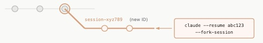

## 介绍

Claude Code 是 一个聪明且能干活的变成伙伴。
- 聪明是指大模型，负责思考和推理；
- 能干活是工具，负责执行，将反馈给到大模型。

### 工具能力

- **文件操作**：读文件、改代码、新建文件、重命名
- **搜索**：按文件名或正则表达式快速找代码
- **执行命令**：运行 npm、git、测试、启动服务器等
- **网络搜索**：查文档、查错误信息
- **代码智能**：查看类型错误、跳转定义、找引用（需安装对应语言插件）

## 工作流程

- 收集上下文
- 采取行动
- 验收结果

## 日常操作交互式命令

### 会话管理与上下文

| 命令 | 说明 | 示例 |
| --- | --- | --- |
| /resume | 列举历史会话，选择恢复哪个会话 命令 claude --resume | 终端命令：claude --resume   |
| /continue | 继续最近一次历史会话。 注意：不能在多个终端窗口都用continue恢复同一个会话，否则所有消息都会交错混在一起。 | 终端命令：claude --continue   |
| /fork | 分叉会话，尝试新方案且不影响原会话 | 终端命令：claude --continue --fork-session   |
| /compact | 压缩会话旧内容（上下文窗口，记忆容量） | 省空间秘诀： 1、重要规则写入CLAUDE.md。 2、用skills和subagents减少不必要的上下文占用。 |
| /context | 查看当前当前上下文占用 | |
| 两次ESC 或撤销刚才的修改 | 回到之前状态 | |

### 项目初始化与配置

| 命令 | 说明 | 示例 |
| --- | --- | --- |
| /init | | |
| | | |

### 模型与响应控制

| 命令 | 说明 | 示例 |
| --- | --- | --- |
| /model | **切换模型** | - **Sonnet**：最适合日常编码任务（速度快、性价比高）- **Opus**：适合特别复杂的架构设计和深度推理 |
| | | |
| | | |

## 权限模式

按  Shift + Tab 快速切换。

| 模式名称 | 核心逻辑 | 具体表现 | 适用场景 |
| --- | --- | --- | --- |
| Plan Mode On 规划模式 | 只读分析，禁止动手。 | 在这个模式下，AI 只能读取代码、搜索文件、分析架构并为你制定详细的修改计划（Plan）。它**绝对不会**修改任何文件内容，也不会执行任何带有副作用的终端命令。 | 刚接手复杂项目、需要重构大模块前，用来和 AI 对齐思路、审查方案，确保安全无误。 |
| Manual Mode On 手动模式 / 默认安全模式 | 步步请示，严格审批。 | 这是最保守、最安全的执行模式。每当 AI 想要编辑文件、创建文件或运行终端命令（如 `npm test`、`git commit`）时，都会暂停并弹出提示，**必须经过你手动确认（批准）后才会执行**。 | 处理核心生产代码、进行高风险操作，或者你希望完全掌控每一步代码改动时。 |
| Accept Edits On 自动接受编辑模式 | 改文件放行，跑命令请示。 | 这是日常开发最常用的折中模式。AI 可以**直接自动创建、修改或删除项目文件**，无需你逐个点击确认；但一旦涉及运行终端命令（Bash/Shell）或外部工具调用，依然会暂停下来向你请求授权。 | 常规的功能开发和 Bug 修复。既能避免频繁确认文件修改带来的打断感，又能防止 AI 乱跑危险的系统命令。 |
| Auto Mode On 全自动模式 / YOLO 模式 | **完全放权，一路绿灯。** | AI 拥有最高执行权限。无论是修改代码文件，还是运行终端命令（安装依赖、跑测试、执行脚本等），它都会**全部自动执行，不会中途弹窗打断你**（部分极端危险的系统级破坏命令可能仍受底层安全机制限制）。 | 在沙盒/容器环境、独立 Git 分支中处理批量任务，或者让 AI 自主循环跑测试直到修复所有报错。 --- |

## 重要文件

| 命令 | 说明 | 示例 |
| --- | --- | --- |
| CLAUDE.md | | |
| MEMORY.md | | |
| settings | 位置：.claude/settings.json | |

## 进阶

- skills（技能）
- MCP（外部服务）
- hooks（自动化）
- subagents（子助手）
